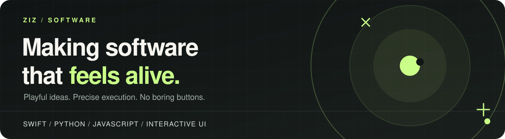
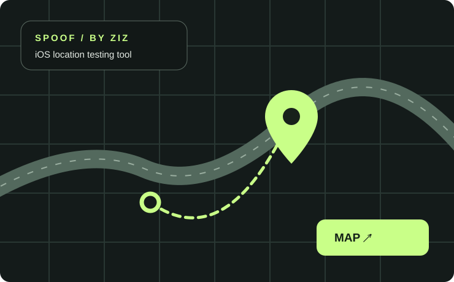
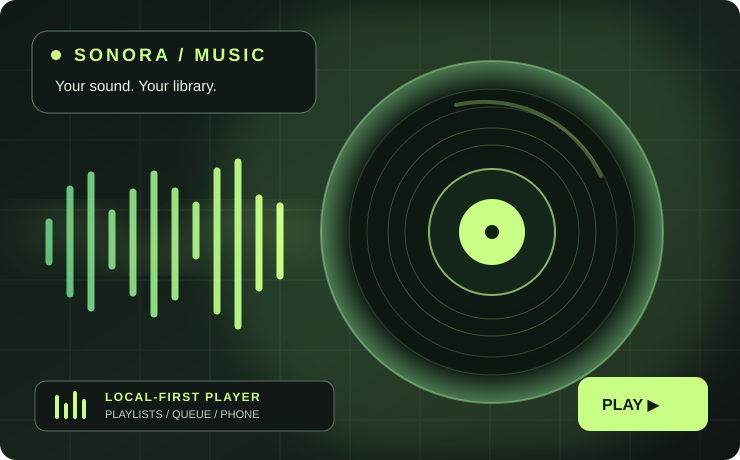
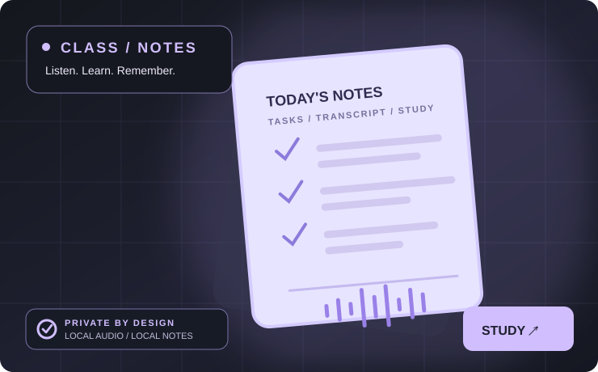

  

  <a href="https://buzzword365.github.io"><strong>PORTFOLIO ↗</strong></a>
  &nbsp;&nbsp;·&nbsp;&nbsp;
  <a href="https://github.com/buzzword365?tab=repositories"><strong>PROJECTS ↗</strong></a>
  &nbsp;&nbsp;·&nbsp;&nbsp;
  <a href="https://github.com/buzzword365/weather-eyes"><strong>LATEST BUILD ↗</strong></a>

### Hey, I'm Ziz 👋

I build **playful, practical software** — interactive desktop experiences, visual tools and experiments that make everyday technology a little more interesting.

I care about the tiny details: how something moves, how it responds, and how it *feels* to use.

 

### ✳ Selected work

<table>
  <tr>
    <td width="50%" valign="top">
      
      <h3><a href="https://github.com/buzzword365/weather-eyes">Weather Eyes ↗</a></h3>
      
An expressive macOS live wallpaper with cursor-following eyes, daily colourway rolls, and a sky that reacts to real weather in a location you choose.

      
<code>Swift</code> <code>WebKit</code> <code>JavaScript</code> <code>Canvas</code>

    </td>
    <td width="50%" valign="top">
      
      <h3><a href="https://github.com/buzzword365/spoof-by-ziz">Spoof by Ziz ↗</a></h3>
      
A local iPhone GPS simulation tool for development and testing, with a map interface and USB-connected device support.

      
<code>Python</code> <code>Swift</code> <code>Leaflet</code> <code>HTML</code>

    </td>
  </tr>
  <tr>
    <td width="50%" valign="top">
      
      <h3><a href="https://github.com/buzzword365/sonora-music">Sonora Music ↗</a></h3>
      
Local-first macOS music player with playlists, queue management, media controls and a paired phone companion. The public release includes the compiled frontend.

      
<code>Electron</code> <code>React</code> <code>JavaScript</code> <code>Node.js</code>

    </td>
    <td width="50%" valign="top">
      
      <h3><a href="https://github.com/buzzword365/class-notes">Class Notes ↗</a></h3>
      
A private, local-first class transcript and study organiser that extracts homework, test dates and key points. Users create their own timetable.

      
<code>Python</code> <code>PySide6</code> <code>SQLite</code> <code>Whisper</code>

    </td>
  </tr>
</table>

### 🛠 Things I build with

  
  
  
  
  
  

### What you'll find here

- **Desktop experiments** with personality and polished interactions.
- **Developer utilities** for testing, learning and exploring.
- **Small ideas taken seriously** — built, tested and refined.

  Designed to be useful. Built to be fun. 
  <a href="https://buzzword365.github.io">Explore the full portfolio →</a>

